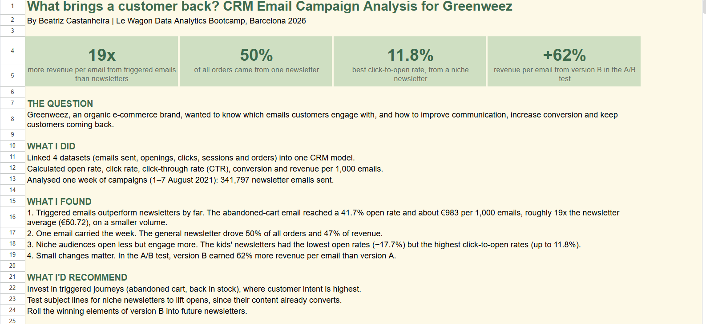

# What brings a customer back? CRM email analysis for Greenweez

**By Beatriz Castanheira** · Le Wagon Data Analytics Bootcamp, Barcelona 2026

**[Open the full analysis in Google Sheets](https://docs.google.com/spreadsheets/d/1l2kE_sxv13pg99mOsjTQCGVaoGfrocfeeMLJE-H-nDM/edit?usp=sharing)**

## The question
Greenweez, an organic e-commerce brand, wanted to know which emails customers engage with, and how to improve communication, increase conversion and keep customers coming back.

## What I did
- Linked 4 datasets (emails sent, openings, clicks, sessions and orders) into one CRM model in Google Sheets
- Calculated open rate, click rate, click-to-open rate (CTR), conversion and revenue per 1,000 emails
- Analysed one week of campaigns (1–7 August 2021): 341,797 newsletter emails

## Key numbers
| 19x | 50% | 11.8% | +62% |
|:---:|:---:|:---:|:---:|
| more revenue per email from triggered emails than newsletters | of all orders came from one newsletter | best click-to-open rate, from a niche newsletter | revenue per email from version B in the A/B test |

## Results by email
| Email | Emails sent | Open rate | Click-to-open (CTR) | Orders | € per 1,000 emails |
|---|---:|---:|---:|---:|---:|
| Abandoned cart (triggered) | 1,948 | 41.7% | 28.9% | 29 | €983.37 |
| General newsletter | 77,182 | 26.0% | 11.2% | 117 | €106.34 |
| Kids' newsletter 2 | 15,151 | 17.7% | 11.8% | 10 | €72.69 |
| Kids' newsletter 1 | 15,307 | 17.7% | 11.4% | 9 | €66.85 |
| Summer newsletter | 95,514 | 23.4% | 8.7% | 42 | €38.74 |
| Household B (A/B test) | 52,272 | 22.3% | 10.2% | 26 | €31.50 |
| Household A (A/B test) | 47,046 | 25.2% | 10.1% | 14 | €19.39 |
| Natural newsletter | 39,325 | 21.6% | 11.3% | 14 | €18.92 |
| **All newsletters** | **341,797** | **23.3%** | **10.2%** | **232** | **€50.72** |

## What I found
1. **Triggered emails outperform newsletters by far.** The abandoned-cart email earned about €983 per 1,000 emails, roughly 19x the newsletter average.
2. **One email carried the week.** The general newsletter drove 50% of all orders and 47% of revenue.
3. **Niche audiences open less but engage more.** The kids' newsletters had the lowest open rates but the highest click-to-open rates.
4. **Small changes matter.** In the A/B test, version B earned 62% more revenue per email than version A.

## What I'd recommend
- Invest in triggered journeys (abandoned cart, back in stock), where customer intent is highest
- Test subject lines for niche newsletters to lift opens, since their content already converts
- Roll the winning elements of version B into future newsletters

## Tools
Google Sheets (data model, pivot tables, KPI calculations), data storytelling
